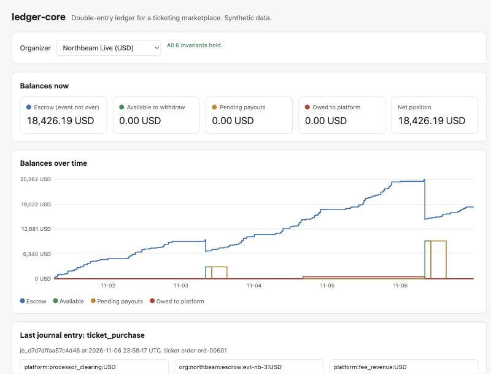
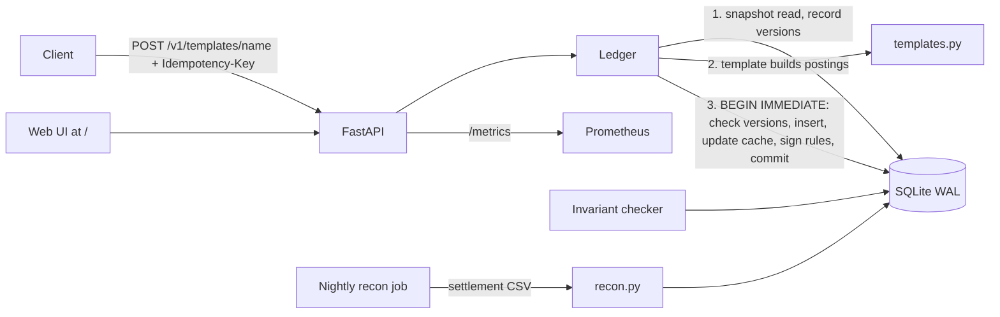

# ledger-core

The money-movement core of a made-up ticketing marketplace. Event organizers sell tickets, the platform holds the money in escrow until the event is over, takes a fee, pays the organizer out, and absorbs refunds and chargebacks. Every one of those flows is a named template that produces double-entry postings in integer minor units. A FastAPI service exposes it with idempotency keys and optimistic concurrency, a nightly job reconciles the ledger against the card processor's settlement file, and an invariant checker proves after every test, stress run, and demo that the books still balance.



| Result | Number |
|---|---|
| Tests | 83 passing (unit, API, Hypothesis property tests, threaded stress test) |
| Demo data | 4 organizers, 9 events, 6 days, 720 orders, 51 partial captures, 21 refunds, 1 chargeback |
| Invariants after demo and after stress | 6 of 6 hold |
| Stress run (16 threads x 100 ops) | 105 version conflicts detected, 70 retried inside the ledger, 216 duplicate client sends, 0 double postings |
| Reconciliation over 6 days of planted breaks | 69 of 69 detected, 0 false flags (table below) |

## Why

A marketplace ledger has to be right every time, not on average. The usual failures are boring and expensive: a float rounds 0.1 + 0.2 wrong, a retry posts a payout twice, two requests both see 100.00 available and both pay out 80.00, a chargeback arrives after the organizer was already paid, the processor's file disagrees with your books by 1.00 and nobody notices for a month. This project handles each one with a standard pattern and checks the result with invariants instead of trusting it.

| Failure | Pattern used here | Where |
|---|---|---|
| Float rounding | Integer minor units only. Floats are rejected at the API, in `Posting`, and by a `CHECK (typeof(amount) = 'integer')` in SQLite. FX rates are decimal strings. | `money.py`, `db.py` |
| Unbalanced entry | Postings must sum to zero per currency, or nothing is written | `ledger.py` `_post` |
| Someone edits history | Triggers abort any UPDATE or DELETE on entries and postings. Corrections are reversing entries. | `db.py`, `Ledger.reverse` |
| Client retries after a timeout | Idempotency-Key stored with a hash of the request, in the same transaction as the postings | `Ledger._replay`, `_remember` |
| Two payouts race for the same balance | Read set versions checked at commit (optimistic concurrency), plus sign rules enforced inside the write transaction. 409 with a retry hint when retries run out. | `view.py`, `Ledger.execute` |
| Organizer paid, then refund or chargeback | Debt goes to an organizer receivable and is repaid first from their next escrow release | `templates.py` `_draw`, `escrow_release` |
| Cached balance drifts from postings | Cache updated in the same transaction; invariant recomputes from postings | `invariants.py` |
| Processor file disagrees with the ledger | Daily two-pass reconciliation that classifies each break | `recon.py` |

## Architecture



Account codes carry their meaning, so templates can name an account and the ledger creates it on first use with the right type and sign rule:

| Code | Type | Normal side | Can go negative |
|---|---|---|---|
| `platform:bank:USD` | asset | debit | no |
| `platform:processor_clearing:USD` | asset | debit | yes (refunds net against settlement) |
| `platform:fee_revenue:USD` | revenue | credit | no |
| `platform:processing_fees:USD`, `platform:chargeback_fees:USD` | expense | debit | no |
| `platform:fx_position:USD` | asset | debit | yes (FX trading account) |
| `platform:capital:USD` | equity | credit | no |
| `org:<id>:escrow:<event>:USD` | liability | credit | no |
| `org:<id>:available:USD` | liability | credit | no |
| `org:<id>:receivable:USD` | asset | debit | no (this is the "negative organizer balance") |

Postings store signed amounts: positive is a debit, negative a credit. The organizer's balances: escrow is money for events not yet over, available is released money minus payouts in flight (holds), pending is payouts in flight, receivable is what they owe us, and net position is escrow plus available minus receivable.

## Money flows as T-accounts

Each template is a function `(params, view) -> Draft` in `src/ledgercore/templates.py`. Examples use a 50.00 USD ticket. Platform fee is 5% plus 0.99 (3.49 here). The processor is expected to charge 2.9% plus 0.30 (1.75 here).

**ticket_purchase** (card capture, escrowed for the event, includes the platform_fee template)

| Account | Debit | Credit |
|---|---:|---:|
| platform:processor_clearing | 50.00 | |
| org:northbeam:escrow:evt-1 | 3.49 | 50.00 |
| platform:fee_revenue | | 3.49 |

**platform_fee** (on its own, for example a late fee adjustment)

| Account | Debit | Credit |
|---|---:|---:|
| org:northbeam:escrow:evt-1 | x | |
| platform:fee_revenue | | x |

**escrow_release** (after the event; organizer owed us 10.00, so that is repaid first)

| Account | Debit | Credit |
|---|---:|---:|
| org:northbeam:escrow:evt-1 | 46.51 | |
| org:northbeam:receivable | | 10.00 |
| org:northbeam:available | | 36.51 |

**organizer_payout** (fails with 422 if it exceeds available minus holds)

| Account | Debit | Credit |
|---|---:|---:|
| org:northbeam:available | 36.51 | |
| platform:bank | | 36.51 |

**refund_before_payout** (money still with us: from escrow, then available; fails rather than create debt)

| Account | Debit | Credit |
|---|---:|---:|
| org:northbeam:escrow:evt-1 (or available) | 46.51 | |
| platform:fee_revenue | 3.49 | |
| platform:processor_clearing | | 50.00 |

**refund_after_payout** (organizer has 20.00 left; the 26.51 shortfall becomes organizer debt)

| Account | Debit | Credit |
|---|---:|---:|
| org:northbeam:available | 20.00 | |
| org:northbeam:receivable | 26.51 | |
| platform:fee_revenue | 3.49 | |
| platform:processor_clearing | | 50.00 |

**chargeback** (after payout; processor pulls the ticket plus a 15.00 dispute fee, the platform eats the fee)

| Account | Debit | Credit |
|---|---:|---:|
| org:northbeam:receivable | 46.51 | |
| platform:fee_revenue | 3.49 | |
| platform:chargeback_fees | 15.00 | |
| platform:processor_clearing | | 65.00 |

The receivable is recovered from future sales by the next `escrow_release` (see above). In the demo, Northbeam Live is paid for its first event, takes a chargeback and a late refund on day 4, and the 487.27 it owes is taken out of its next event's release on day 6.

**processor_settlement** (processor pays the batch, net of its fee)

| Account | Debit | Credit |
|---|---:|---:|
| platform:bank | 48.25 | |
| platform:processing_fees | 1.75 | |
| platform:processor_clearing | | 50.00 |

**fx_conversion** (1,000.00 USD to EUR at "0.9213"; each currency balances on its own)

| Account | Debit | Credit |
|---|---:|---:|
| platform:bank:USD | | 1,000.00 USD |
| platform:fx_position:USD | 1,000.00 USD | |
| platform:bank:EUR | 921.30 EUR | |
| platform:fx_position:EUR | | 921.30 EUR |

**capital_injection** (Dr bank, Cr capital) and **manual_transfer** (Dr one account, Cr another, same currency, sign rules apply) complete the set. **Reversal** is not a template: `POST /v1/entries/{id}/reverse` posts the exact negation, linked by `reverses_entry_id`, and can happen only once.

### Holds and authorizations

- **Payout hold** (`POST /v1/payouts`): reserves funds on `available`. Available drops now, pending rises. Capture (`POST /v1/holds/{id}/capture`, full or partial) posts `organizer_payout` and releases the rest. Release or expiry frees the money. No posting can spend held funds.
- **Card authorization** (`POST /v1/authorizations`): shows as incoming on the event's escrow. Partial capture posts `ticket_purchase` for the captured amount, for example 2 of 3 seats.
- Holds expire at `expires_at` (7 days for auths, 3 for payouts). Expired holds stop counting immediately; `POST /v1/holds/expire` sweeps them.
- Point-in-time queries include holds: a hold counts at time T if it was created before T and not yet closed or expired.

## How to run

Docker is not needed. Docker files are built in CI.

```bash
cd ledger-core
uv sync --python 3.12

# Six days of synthetic activity into data/ledgercore.db, then the invariant result.
uv run ledgercore demo --fresh

# API and web UI at http://127.0.0.1:8000
uv run ledgercore api --port 8000

# Reconcile one day against a generated settlement file with planted breaks.
uv run ledgercore recon --day 2026-11-04
# Or write the CSV first and reconcile that file.
uv run ledgercore gen-settlement --day 2026-11-04 --out data/settlement-2026-11-04.csv
uv run ledgercore recon --day 2026-11-04 --settlement data/settlement-2026-11-04.csv --out data/recon.md

# Detection score over every day in the database.
uv run ledgercore recon-eval

# 16 threads x 100 random operations with retries, then invariants.
uv run ledgercore stress --threads 16 --ops 100

uv run ledgercore invariants
```

API examples:

```bash
curl -s -X POST localhost:8000/v1/templates/ticket_purchase \
  -H 'Idempotency-Key: buy-ord-9001' -H 'content-type: application/json' \
  -d '{"params": {"order_id": "ord-9001", "organizer": "northbeam", "event_id": "evt-nb-3", "gross": 4900}}'

curl -s localhost:8000/v1/organizers/northbeam/balances
curl -s 'localhost:8000/v1/organizers/northbeam/balances?as_of=2026-11-04T17:00:00Z'
curl -s 'localhost:8000/v1/accounts/org:northbeam:available:USD/statement'
curl -s 'localhost:8000/v1/entries?limit=20'
curl -s localhost:8000/v1/invariants
curl -s localhost:8000/metrics
```

A float amount (`"gross": 49.0`) gets a 422. Sending the same Idempotency-Key with the same body returns the original entry with `Idempotent-Replayed: true`; with a different body it returns 422. A stale `expected_versions` or exhausted internal retries return 409 with `Retry-After` and `"retryable": true`.

| Endpoint | Purpose |
|---|---|
| `POST /v1/templates/{name}` | Run a money-flow template (Idempotency-Key required) |
| `POST /v1/transfers` | Two-leg manual transfer |
| `POST /v1/payouts`, `POST /v1/authorizations` | Create a payout hold or a card authorization |
| `POST /v1/holds/{id}/capture`, `/release`, `POST /v1/holds/expire` | Hold lifecycle |
| `POST /v1/entries/{id}/reverse` | Reversing entry |
| `GET /v1/accounts/{code}`, `/balance?as_of=`, `/statement?start=&end=` | Balances and statements |
| `GET /v1/organizers/{id}/balances?as_of=`, `/history`, `/statement` | Organizer view |
| `GET /v1/entries`, `GET /v1/entries/{id}` | Journal, newest first, cursor by `before_id` |
| `GET /v1/invariants`, `/healthz`, `/metrics` | Operations |

## Reconciliation

The processor's file for a day holds every capture and refund up to its 23:55 UTC cutoff. Anything later lands in the next day's file, which is the timing difference across midnight. The generator builds the file from the ledger and plants one missing settlement, one amount mismatch, one duplicate line, one fee difference, one line with a blank reference, and one line the ledger has never seen.

Matching runs in two passes. Exact: processor reference and type, then compare gross and fee. Fuzzy: lines without a usable reference match an unmatched ledger item with the same currency, type, and gross within two hours, closest in time first. Leftovers become breaks. Real output for 2026-11-04 from the demo database:

| Status | Count |
|---|---:|
| matched | 118 |
| matched_fuzzy | 1 |
| timing_difference | 6 |
| missing_settlement | 1 |
| amount_mismatch | 1 |
| duplicate | 1 |
| fee_difference | 1 |
| unexpected_line | 1 |

Breaks needing action: 5. Timing differences (clear on their own): 6.

| Status | Processor ref | Type | Ledger | Settled | Fee exp. | Fee settled | Note |
|---|---|---|---:|---:|---:|---:|---|
| amount_mismatch | psp_ord-00390 | CAPTURE | 140.00 USD | 139.00 USD | 4.36 USD | 4.36 USD | diff -100 |
| duplicate | psp_ord-00393 | CAPTURE |  | 480.00 USD |  | 14.22 USD | repeat line L20261104-00012-DUP |
| fee_difference | psp_ord-00459 | CAPTURE | 70.00 USD | 70.00 USD | 2.33 USD | 2.41 USD | fee +8 |
| matched_fuzzy | psp_ord-00414 | CAPTURE | 147.00 USD | 147.00 USD | 4.56 USD | 4.56 USD | line L20261104-00045 had ref (blank); 1 candidate(s) |
| missing_settlement | psp_ord-00436 | CAPTURE | 35.00 EUR |  | 1.32 EUR |  | ledger entry 433 at 13:17, no settlement line |
| timing_difference | psp_ord-00241 | CAPTURE | 35.00 EUR | 35.00 EUR | 1.32 EUR | 1.32 EUR | ledger 2026-11-03 23:56, settled 2026-11-04 |
| timing_difference | psp_ord-00242 | CAPTURE | 75.00 USD | 75.00 USD | 2.48 USD | 2.48 USD | ledger 2026-11-03 23:57, settled 2026-11-04 |
| timing_difference | psp_ord-00243 | CAPTURE | 480.00 USD | 480.00 USD | 14.22 USD | 14.22 USD | ledger 2026-11-03 23:58, settled 2026-11-04 |
| timing_difference | psp_ord-00361 | CAPTURE | 225.00 EUR |  | 6.83 EUR |  | after 23:55 cutoff, expected in next file |
| timing_difference | psp_ord-00362 | CAPTURE | 25.00 USD |  | 1.03 USD |  | after 23:55 cutoff, expected in next file |
| timing_difference | psp_ord-00363 | CAPTURE | 300.00 USD |  | 9.00 USD |  | after 23:55 cutoff, expected in next file |
| unexpected_line | psp_unknown_4001 | CAPTURE |  | 43.21 USD |  | 1.55 USD | line L20261104-99999 has no ledger entry |

Evaluation over all 6 demo days (`ledgercore recon-eval`). Flagged counts every result with that status, so precision below 100% would mean false alarms.

| Class | Planted | Detected | Flagged | Recall | Precision |
|---|---:|---:|---:|---:|---:|
| timing_difference | 33 | 33 | 33 | 100% | 100% |
| missing_settlement | 6 | 6 | 6 | 100% | 100% |
| amount_mismatch | 6 | 6 | 6 | 100% | 100% |
| duplicate | 6 | 6 | 6 | 100% | 100% |
| fee_difference | 6 | 6 | 6 | 100% | 100% |
| unexpected_line | 6 | 6 | 6 | 100% | 100% |
| matched_fuzzy | 6 | 6 | 6 | 100% | 100% |

These breaks are planted by the same team that wrote the matcher, so 100% says the logic is wired correctly, not that it would catch every real-world break. Two lines with the same amount and no reference inside the two-hour window would be matched to the closest one, which can be wrong; the report notes the candidate count so a person can check.

## Invariants

`ledgercore invariants`, `GET /v1/invariants`, and the `ledgercore_invariant_ok` gauge run six checks:

1. Every entry, and the whole ledger, sums to zero per currency. Each posting's currency matches its account.
2. No account breaks its sign rule (escrow, available, receivable, bank, fee revenue, and expenses never go negative).
3. Cached balances and versions equal a full recompute from postings.
4. Every payout is covered: walking each organizer's history in order, cumulative payouts never exceed cumulative escrow released to available.
5. Active payout holds never exceed the balance they reserve.
6. Every reversal exactly mirrors its original entry.

## Tests

83 tests, 10 to 15 seconds on a laptop: `uv run pytest -q`.

| File | Count | What it checks |
|---|---:|---|
| `test_money.py` | 11 | Floats, bools, Decimals rejected; banker's rounding for FX; formatting |
| `test_ledger.py` | 19 | Balance per currency, immutability triggers, reversals, point-in-time balances, statements, idempotency, optimistic conflicts and retries, 20 threads racing for one balance |
| `test_templates.py` | 16 | Exact postings for every template; refund and chargeback waterfalls; debt recovered from the next release; FX |
| `test_holds.py` | 10 | Available vs pending, partial capture, expiry, card auth to purchase, stale version 409 |
| `test_invariants.py` | 5 | Each check passes on a clean ledger and catches deliberate tampering |
| `test_recon.py` | 7 | Every planted break class found, clean file has no breaks, fuzzy and amount cases |
| `test_property.py` | 3 | Hypothesis: random sequences of up to 40 operations (buy, refund, chargeback, release, payout, holds, reversals, clock jumps) keep all invariants after every step; only balanced entries are accepted; FX rounding stays within half a minor unit |
| `test_api.py` | 11 | Idempotency replay and mismatch, float rejection, 409 with retry hint, statements, pagination, payout flow, UI |
| `test_stress.py` | 1 | 8 threads x 40 random operations with retries and resends (size set by `LEDGERCORE_STRESS_THREADS` and `_OPS`), then invariants and no double postings |

## DevOps

- `Dockerfile`: multi-stage, uv, non-root user 10001, `HEALTHCHECK` through `ledgercore healthcheck`.
- `docker-compose.yml`: a one-shot `seed` job loads demo data, then the API starts on the same volume. `docker compose --profile jobs run recon` runs reconciliation.
- `.github/workflows/ci.yml`: ruff, pytest (with a small stress run), demo plus invariants plus recon evaluation, Docker build, a smoke test of the image, and `docker compose config`.
- `deploy/k8s/` (illustrative, not run against a cluster): Deployment with probes, resource limits, read-only root filesystem and zone spreading; Service; PodDisruptionBudget (`maxUnavailable: 1`); a CronJob that reconciles yesterday at 02:15 UTC; ConfigMap and PVC. The Deployment asks for 3 replicas, which assumes the Postgres backend from Production notes. With the SQLite file in this repo, run 1 replica.
- `/metrics`: entries posted by template, optimistic conflicts and retries, idempotent replays, rejections by code, HTTP latency histogram, active holds, and one gauge per invariant. Logs are one JSON object per line with a request id.

## Production notes

- **Database and isolation:** Postgres with `schema/postgres.sql`. Money-moving transactions run at SERIALIZABLE and retry on SQLSTATE 40001, or at READ COMMITTED with `SELECT ... FOR UPDATE` on the balance rows, locked in account id order. The version column supports the same optimistic path used here (`UPDATE ... WHERE version = $n`). A deferred constraint trigger checks that each entry balances at commit.
- **Hot accounts:** platform accounts like `processor_clearing` take a write on every sale. At high volume they would be split into sub-accounts or updated by a batch that sums postings, so one row lock does not serialize all traffic.
- **Idempotency keys:** scoped per client and kept for a bounded window (for example 30 days), longer than any client's retry horizon.
- **Reconciliation:** real files arrive over SFTP or an API in the processor's own format, with batch-level net amounts as well as lines. Breaks would open cases in a finance operations queue with owners and aging, and timing differences would be checked off automatically when the next file lands.
- **FX:** rates from a provider with a timestamp and source on each entry, and a periodic revaluation entry that books unrealized gain or loss on the FX position accounts.
- **Audit:** append-only tables plus a hash chain over entries, and the application role granted only INSERT and SELECT on ledger tables.

## License

MIT. See [LICENSE](LICENSE).
